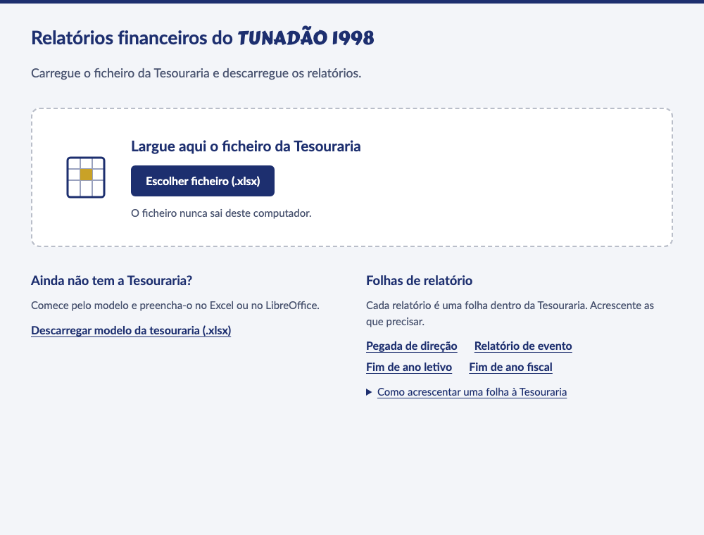
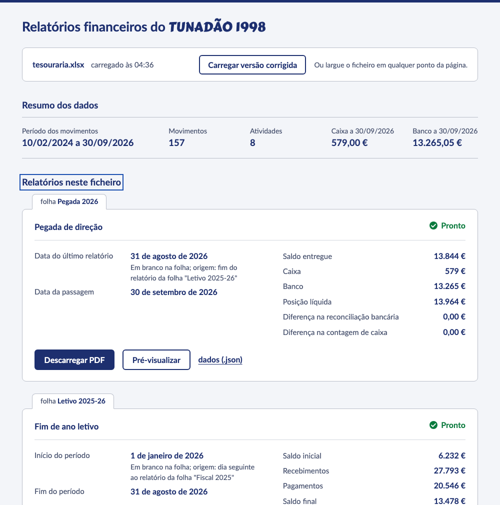
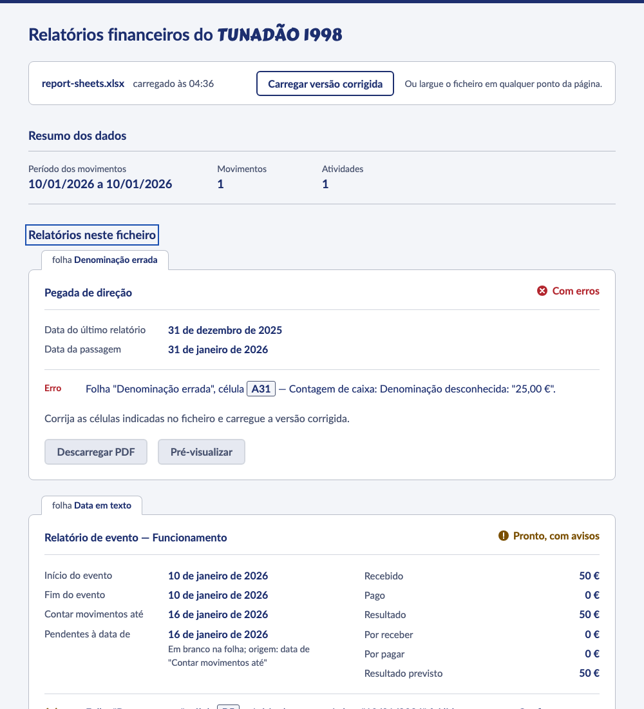
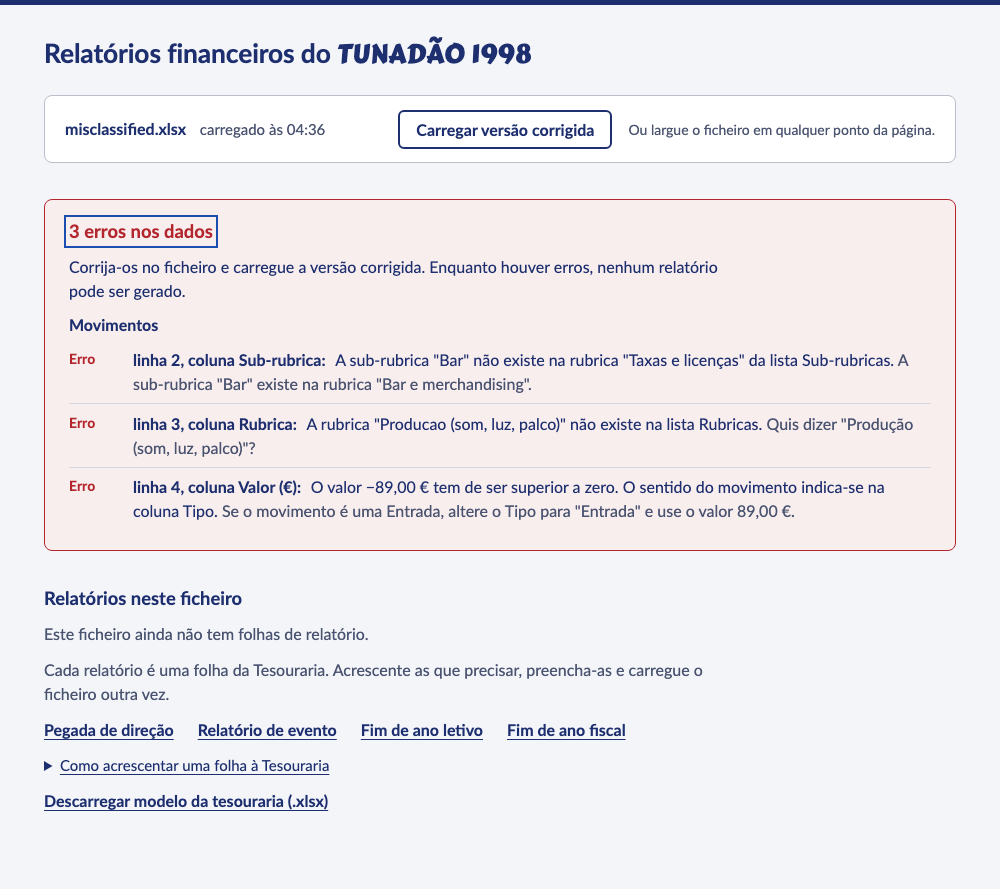
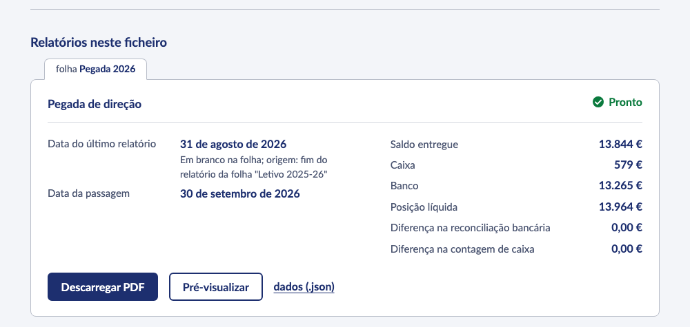
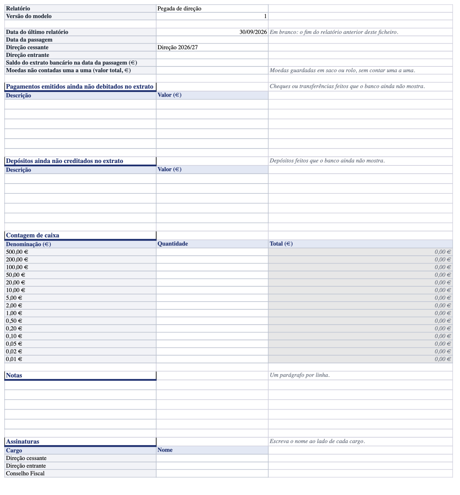

# Gerador de relatórios financeiros — TUNADÃO 1998

Página estática e CLI que leem a folha de Tesouraria (`.xlsx`) e geram os relatórios financeiros da tuna em PDF.
Tudo acontece no navegador, neste computador: os dados nunca são enviados para lado nenhum. Depois da primeira
visita a página funciona também sem ligação à internet.

Há quatro relatórios: **Relatório de evento**, **Pegada de direção**, **Fim de ano letivo** e **Fim de ano fiscal**.
Cada relatório é uma folha da própria Tesouraria: tudo o que o relatório precisa escreve-se no ficheiro, nunca na
página.

## Como usar a página

O percurso cabe num só ecrã e a página não tem formulários.



1. **Abra a página** e largue o ficheiro da Tesouraria (`.xlsx`) na zona indicada, ou use «Escolher ficheiro». Se
   ainda não tem o ficheiro, «Descarregar modelo da tesouraria (.xlsx)» dá-lhe um modelo vazio.
2. **Veja o que o ficheiro tem.** A página lê o ficheiro neste computador e mostra um resumo dos dados (período dos
   movimentos, número de movimentos e atividades, caixa e banco no último dia) e uma entrada por folha de relatório,
   da mais recente para a mais antiga.

   

   Cada entrada diz o estado da folha (**Pronto**, **Pronto, com avisos**, **Com erros**, **Por preencher** ou
   **Bloqueado pelos dados**), escreve por extenso todas as datas do relatório (e de onde veio cada data que ficou em
   branco) e mostra os valores principais. Confira as datas e os valores antes de descarregar.

3. **Corrija o que for preciso, no ficheiro.** Cada erro diz a folha e a célula (`Folha "Pegada 2026", célula B8`);
   nos separadores de dados diz a linha e a coluna. Os erros impedem a geração, os avisos não. Edite o ficheiro na
   folha de cálculo, grave-o e carregue a versão corrigida: o botão «Carregar versão corrigida», ou largar o ficheiro
   em qualquer ponto da página, substitui tudo o que estava listado.

   

   Se os erros estiverem nos separadores de dados (Movimentos, Saldos, …), nenhum relatório fica pronto até serem
   corrigidos.

   

4. **Descarregue.** «Descarregar PDF» gera e guarda o PDF dessa folha; «Pré-visualizar» mostra-o por baixo da entrada
   sem sair da página; «dados (.json)» guarda os números do relatório. Os ficheiros chamam-se, por exemplo,
   `2026-09-30 Pegada de direção.pdf` ou `2026-06-15 Relatório de evento - 20º CITADÃO.pdf` (a data é a do fim do
   relatório).
5. **Ou descarregue tudo de uma vez.** «Descarregar todos (.zip)» gera os PDFs de todas as folhas prontas, um a um
   («A gerar 2 de 5…»), e guarda-os num só ficheiro `Relatórios.zip`. Os PDFs que já tinha gerado nessa visita
   não se geram outra vez. A linha por baixo do botão diz quantos relatórios entraram e nomeia as folhas que ficaram
   de fora e porquê.
6. **Prepare as folhas seguintes.** Quando o ficheiro já tem uma pegada ou um período fechado, a página oferece em
   «Próximas folhas» a pegada seguinte (com a data do último relatório e a direção cessante já escritas) e o fim de
   ano letivo seguinte (com o início do período). Descarregue-as, acrescente-as à Tesouraria e preencha o resto.

   

Na primeira utilização a página descarrega o motor de PDF (cerca de 10 MB). Se pedir um PDF antes de ele estar pronto,
aparece «A preparar o motor de PDF… N %». Depois disso fica guardado no navegador e a página abre e gera relatórios
mesmo sem internet. Quando há uma versão nova, aparece «Nova versão disponível» com o botão «Recarregar».

Só são aceites ficheiros `.xlsx`. No LibreOffice use «Guardar como» `.xlsx`; no Google Sheets use «Ficheiro, Transferir,
Microsoft Excel (.xlsx)».

## Como está organizada a Tesouraria

O ficheiro tem **separadores de dados** (a contabilidade do dia a dia) e **uma folha por relatório**.

| Separador           | Para quê                                                                                                                                                                                                                                                |
| ------------------- | ------------------------------------------------------------------------------------------------------------------------------------------------------------------------------------------------------------------------------------------------------- |
| Instruções          | Guia curto dentro do próprio ficheiro, com um exemplo. A página ignora-o.                                                                                                                                                                               |
| Listas              | As rubricas, sub-rubricas, atividades, meios e orçamentos que aparecem nas listas suspensas. Não há nada para mudar no código.                                                                                                                          |
| Saldos              | Pontos de controlo do dinheiro de cada conta (Caixa ou Banco) no fim de um dia, com a fonte (Extrato, Contagem ou Declarado). A primeira linha de cada conta é o saldo de abertura: escreva-a com a fonte **Declarado** e não a registe como movimento. |
| Movimentos          | Cada recebimento e cada pagamento, com a data em que o dinheiro entrou ou saiu. O valor é sempre positivo; o sentido está na coluna Tipo (Entrada ou Saída). As colunas cinzentas, marcadas «(automático)», são calculadas: não as edite.               |
| Pendentes           | Valores a receber e dívidas a pagar ainda não liquidados.                                                                                                                                                                                               |
| Orçamento           | O orçado por rubrica, para uma atividade ou para um período (por exemplo «20º CITADÃO» ou «2026»). O nome do orçamento tem de existir em Listas.                                                                                                        |
| Géneros             | Apoios em espécie. Ficam listados à parte e nunca entram no saldo.                                                                                                                                                                                      |
| Folhas de relatório | Uma por relatório que quer gerar: «Modelo Pegada», «Modelo Evento», «Modelo Letivo» e «Modelo Fiscal» vêm no modelo; o nome pode ser qualquer um.                                                                                                       |

Casos especiais nos Movimentos:

- _Reembolso_: se recebeu de volta dinheiro de uma despesa (por exemplo, uma caução), registe uma **Entrada com a
  rubrica dessa despesa**. O valor abate à despesa e não conta como receita.
- _Transferência entre contas_ (por exemplo, depositar numerário no banco): duas linhas com a rubrica
  «Transferências internas», uma Saída na conta de origem e uma Entrada na de destino, com o mesmo valor e a mesma
  data. Não contam como receita nem despesa.
- _Sub-rubrica_: é opcional. Vazia, o movimento fica na própria rubrica. Escolha uma que pertença à rubrica indicada.
- **Uma atividade por edição de cada evento que se repete.** O relatório de evento soma todos os movimentos da
  atividade, por isso edições com o mesmo nome seriam somadas. Use «Zumba na Caneca 2025» e «Zumba na Caneca 2026»,
  nunca apenas «Zumba na Caneca», e acrescente cada nova atividade em Listas.

### Uma folha por relatório

Uma folha de relatório é um pequeno formulário escrito na própria folha de cálculo: os nomes dos campos na coluna A,
os valores na coluna B e, por baixo, quadros com título (pagamentos ainda não debitados, contagem de caixa, notas,
assinaturas). A coluna C traz uma dica a cinzento que a página não lê.



- **O tipo vem de uma célula, não do nome da folha.** A célula «Relatório» (linha 1) diz de que relatório se trata, e a
  folha pode chamar-se como quiser («Pegada 2026», «CITADÃO 2026», …). A célula «Versão do modelo» (linha 2) diz com
  que versão do modelo a folha foi criada; se a apagar, a página assume a versão 1.
- **A página lê o que está escrito nas células**, pelo nome do campo, por isso pode inserir ou mexer linhas dentro da
  folha. As listas suspensas, as cores e as fórmulas são só conforto: uma fórmula nunca conta como valor, e uma célula
  que só tem fórmula, sem valor guardado, é um erro («abra e grave o ficheiro na folha de cálculo antes de carregar»).
- **Datas deixadas em branco que o ficheiro já conhece.** Na pegada, «Data do último relatório» fica igual ao fim do
  relatório anterior do ficheiro; no fim de ano letivo, «Início do período» fica igual ao dia seguinte ao fim do
  relatório anterior; no relatório de evento, «Pendentes à data de» fica igual a «Contar movimentos até» (ou ao
  último movimento do ficheiro). A página escreve sempre a data por extenso e a origem, para a confirmar.
- **Textos compridos**: um parágrafo por linha. Para mudar de linha dentro da mesma célula use Alt+Enter no Excel e
  Ctrl+Enter no LibreOffice e no Google Sheets.
- **O saldo do extrato bancário da pegada** escreve-se na própria folha («Saldo do extrato bancário na data da
  passagem»). Uma linha de Saldos com a fonte «Extrato» já não o preenche.

### Como acrescentar uma folha de relatório

1. Descarregue a folha em branco na página inicial (Pegada de direção, Relatório de evento, Fim de ano letivo ou Fim de
   ano fiscal), ou use as «Próximas folhas» pré-preenchidas.
2. Insira-a na Tesouraria:
   - **Excel**: botão direito num separador, «Mover ou Copiar…», escolha a Tesouraria como destino e marque «Criar uma
     cópia».
   - **LibreOffice**: «Folha, Inserir folha a partir de ficheiro…».
   - **Google Sheets**: «Ficheiro, Importar», separador «Carregar», e em «Local de importação» escolha «Inserir novas
     folhas». **Antes de preencher, escolha «Ficheiro, Definições, Região: Portugal»** (basta uma vez), para as datas
     serem lidas como dia/mês/ano.
3. Preencha a folha, grave a Tesouraria como `.xlsx` e carregue-a na página.

Para uma segunda pegada ou outro evento, copie a folha («Duplicar» em qualquer das aplicações) e altere os valores.

### Se já tem uma Tesouraria da versão anterior

Os separadores de dados continuam a ser lidos como estavam. Faltam-lhe só as folhas de relatório: a página mostra-o com
as quatro folhas em branco para descarregar. Mudanças a ter em conta:

- Os valores que antes se escreviam na página (datas, nomes, notas, parecer, contagem de caixa, saldo do extrato
  bancário) escrevem-se agora na folha do relatório.
- **O saldo de abertura já não se escreve na página.** Declare-o em Saldos, numa linha com a fonte «Declarado».
- **Os ficheiros CSV já não são aceites**: guarde o conjunto como um só `.xlsx`.
- Linhas de exemplo do modelo antigo marcadas como «(exemplo fictício)» são agora erros: apague-as.

## Como gerar pela linha de comandos

Quem prefere o terminal (ou quer automatizar) usa `npm run gerar`, que corre o mesmo pipeline de `src/core` e o mesmo wasm do Typst que a página (`typst-node.ts`), sem
navegador. O JSON do relatório é o mesmo; o PDF não é idêntico byte a byte.

Cada relatório é uma folha do ficheiro `.xlsx`: o tipo e todos os parâmetros vêm dessa folha, por isso não há parâmetros na linha de comandos.

```
npm run gerar -- --entrada <ficheiro.xlsx> --listar
npm run gerar -- --entrada <ficheiro.xlsx> --folha "<nome da folha>"
  [--saida <ficheiro.pdf>] [--json <ficheiro.json>] [--agora aaaa-mm-ddThh:mm] [--ajuda]
```

- `--entrada` é um único ficheiro `.xlsx`.
- `--listar` mostra uma linha por folha de relatório (nome, tipo, estado e datas por extenso), da mais recente para a
  mais antiga, seguida dos problemas dessa folha com a célula: `ERRO|AVISO Folha "nome", célula B5 — campo: mensagem`.
- `--folha` gera o relatório dessa folha (nome exato). Se o nome não existir, o CLI sugere o mais parecido. Uma folha
  com erros mostra os problemas e não escreve nenhum PDF. `--folha` e `--listar` não se combinam, e é preciso um dos dois.
- `--saida` por omissão é `<data> <relatório>.pdf` na pasta atual (por exemplo `2026-09-30 Pegada de direção.pdf`).
  `--json` escreve também o JSON do relatório. Ambos substituem um ficheiro existente.
- `--agora` é a data e hora de geração em hora de Lisboa; por omissão, a hora atual de Lisboa.
- Os problemas dos separadores de dados saem um por linha: `ERRO|AVISO Separador Movimentos, linha N, coluna C — mensagem (sugestão: ...)`. Com `--listar` saem em stdout, antes das folhas, e `npm run -s gerar -- --entrada tesouraria.xlsx --listar > lista.txt` guarda tudo (`-s` esconde o cabeçalho do npm); ao gerar uma folha saem em stderr.
- `--tipo`, `--param` e `--params` já não existem; usá-los é um erro de utilização que indica a alternativa.

| Código | Significado                                                           |
| ------ | --------------------------------------------------------------------- |
| 0      | PDF gerado (pode haver avisos), ou lista impressa                     |
| 1      | erros nos separadores de dados ou na folha pedida; nenhum PDF escrito |
| 2      | utilização incorreta: argumentos, ficheiro ou nome de folha inválidos |
| 3      | erro interno ao gerar o relatório ou o PDF                            |

Exemplos com os dados fictícios do repositório (a pasta `saida/` é ignorada pelo git e tem de existir):

```
mkdir -p saida
npm run gerar -- --entrada fixtures/generated/tesouraria.xlsx --listar
npm run gerar -- --entrada fixtures/generated/tesouraria.xlsx --folha "Pegada 2026" --saida saida/pegada.pdf
npm run gerar -- --entrada fixtures/generated/tesouraria.xlsx --folha "Letivo 2025-26" --saida saida/letivo.pdf
npm run gerar -- --entrada fixtures/generated/tesouraria.xlsx --folha "CITADÃO 2026" --saida saida/evento.pdf
npm run gerar -- --entrada fixtures/generated/tesouraria.xlsx --folha "Fiscal 2025" --saida saida/fiscal.pdf --json saida/fiscal.json
npm run gerar -- --entrada fixtures/generated/invalid/report-sheets.xlsx --listar
```

## Como mudar o logo, as rubricas, as cores e as assinaturas

| O quê                                      | Onde                                     | Como                                                                                                       |
| ------------------------------------------ | ---------------------------------------- | ---------------------------------------------------------------------------------------------------------- |
| Logo                                       | `assets/logo.svg`                        | Substitua o ficheiro por outro SVG (mantenha o nome). Aparece no cabeçalho dos PDFs.                       |
| Rubricas, sub-rubricas, atividades e meios | aba **Listas** do modelo                 | Acrescente ou altere linhas na própria folha. Não há nada para mudar no código.                            |
| Cores dos PDFs                             | `config/config.json`, chave `theme`      | Valores `#RRGGBB`. `segments` tem sempre 8 cores (gráficos) e `segmentInk` o texto legível sobre cada uma. |
| Cargos nas linhas de assinatura            | `config/config.json`, chave `signatures` | Uma lista de cargos por relatório (`evento`, `pegada`, `letivo`, `fiscal`).                                |
| Nome e subtítulo da tuna                   | `config/config.json`, chave `org`        | Texto livre.                                                                                               |

O logo e o `config.json` fazem parte da página publicada: depois de os alterar, faça commit para `main` e a
publicação refaz-se sozinha (ver a secção seguinte). Pelo CLI a alteração vale logo. Um `config.json` inválido
impede a página e o CLI de arrancar, com uma mensagem a dizer qual o campo errado.

## Como publicar no GitHub Pages

1. No repositório, abra **Settings → Pages** e escolha **GitHub Actions** em _Source_.
2. Cada push para `main` corre `.github/workflows/deploy.yml`: constrói a página, publica-a e corre um teste de
   fumo sobre o endereço publicado.
3. A página fica em `https://<utilizador>.github.io/<repositório>/`. O caminho base vem da variável de ambiente
   `BASE_PATH` (por omissão `/tunadao-relatorios/`). Se o repositório tiver outro nome, ou a página for servida a
   partir da raiz de um domínio, defina-a no passo de build, por exemplo `BASE_PATH=/outro-nome/ npm run build`
   (ou `BASE_PATH=/` para um domínio próprio).

## Secção de programador

### Stack

- TypeScript (modo estrito), Preact 11, Vite 8, Node 24 (`.nvmrc`).
- Folhas lidas com SheetJS CE 0.20.3 (`vendor/xlsx-0.20.3.tgz`, que não vem do registo npm). O zip e as folhas pré-preenchidas usam `fflate` (só a API síncrona, compatível com a CSP).
- Zod 4 valida os dados, os parâmetros e `config/config.json`.
- PDFs compostos por Typst 0.14.2 em WebAssembly (`@myriaddreamin/typst.ts` e `@myriaddreamin/typst-ts-web-compiler`,
  ambos fixados em `0.7.0`).
- Vitest 5 e Playwright 1.63 para os testes. Todas as dependências estão fixadas sem intervalos de versões.

A regra de arquitetura: leitor → normalizador → dataset canónico → validador → calculador → JSON do relatório →
modelo Typst → PDF. O Typst só desenha números já calculados; todas as contas vivem em TypeScript puro, em
`src/core`.

### Scripts

| Script                                                                                                | O que faz                                                                                          |
| ----------------------------------------------------------------------------------------------------- | -------------------------------------------------------------------------------------------------- |
| `npm run dev` / `npm run preview`                                                                     | servidor de desenvolvimento / pré-visualização do build                                            |
| `npm run build`                                                                                       | build de produção (respeita `BASE_PATH`) e geração do service worker                               |
| `npm run format` / `format:fix`                                                                       | verifica / aplica o Prettier                                                                       |
| `npm run lint` e `npm run typecheck`                                                                  | ESLint e `tsc --noEmit`                                                                            |
| `npm test`                                                                                            | testes unitários e de fixtures (Vitest)                                                            |
| `npm run test:e2e`                                                                                    | Playwright em chromium, firefox e webkit sobre o build, mais o servidor de desenvolvimento         |
| `npm run test:e2e:deployed`                                                                           | fumo, motor e offline contra o endereço em `BASE_URL`                                              |
| `npm run test:visual`                                                                                 | gera os PDFs de exemplo e compara-os com `tests/visual/baselines` (precisa de `pdftoppm`)          |
| `npm run gerar`                                                                                       | CLI                                                                                                |
| `npm run build:template`, `build:starters`, `build:fixtures`, `build:example-json`, `render:examples` | regeneram os ficheiros gerados que estão no repositório; os testes verificam que estão atualizados |

### Fixtures e testes

- `fixtures/src` descreve um conjunto fictício e encadeado de janeiro de 2024 a setembro de 2026. `npm run
build:fixtures` escreve `fixtures/generated` (um `.xlsx` com as cinco folhas de relatório de exemplo e conjuntos
  inválidos, um por classe de erro). `npm run build:starters` escreve as folhas de relatório em branco de
  `public/folhas`. Os testes em `tests/fixtures` afirmam os valores de controlo ao cêntimo.
- `fixtures/v1/` guarda, congelados, os ficheiros da versão anterior (parâmetros, exemplos, modelo e tesouraria) que
  servem de referência aos testes; `examples/*.json` são os relatórios de exemplo gerados a partir das folhas do
  ficheiro `fixtures/generated/tesouraria.xlsx`.
- `tests/e2e` cobre os percursos principais (carregar, descarregar cada PDF e os dados, o zip com os cinco PDFs, as próximas folhas, a correção de erros, a paridade entre a página e o CLI), a política de segurança (nenhum pedido a outras origens, `eval` e
  `new Function` bloqueados no worker) e o funcionamento offline.
- `tests/visual` rasteriza os PDFs de exemplo e compara-os com as imagens de referência.

### Modo offline

`scripts/service-worker-plugin.ts` gera `dist/sw.js` no fim do build a partir de `src/web/sw.ts`, com a lista de todos
os ficheiros construídos (incluindo o wasm, os tipos de letra, os modelos Typst e `modelo-tesouraria.xlsx`) e uma
versão derivada do conteúdo. O worker guarda tudo numa cache com essa versão, apaga as caches antigas ao ativar-se
e responde só a pedidos da própria origem; os restantes seguem para a rede. A CSP não muda. O registo
(`src/web/service-worker.ts`) só acontece em produção. Uma versão nova instala-se em segundo plano e fica à espera:
a página mostra «Nova versão disponível» e, ao carregar em «Recarregar», o worker novo assume e a página recarrega.
Sem esse clique, o worker novo assume quando o separador for fechado e reaberto.

O motor de PDF começa a carregar quando o navegador está livre. Na primeira visita (ainda sem service worker a controlar a
página) qualquer pedido de PDF, mesmo feito logo a seguir a carregar o ficheiro, espera que o worker esteja ativo, para
que o wasm seja descarregado uma só vez, pela pré-colocação em cache; se o registo falhar, carrega na mesma.

O Playwright WebKit não consegue simular «offline» numa página servida por um service worker, por isso o percurso
offline corre em chromium e firefox e o webkit só verifica a cache. O Safari deve ser confirmado à mão no
endereço publicado.

### Motor de PDF

O PDF é composto por Typst, compilado em WebAssembly com `@myriaddreamin/typst.ts` e `@myriaddreamin/typst-ts-web-compiler`
(ambos fixados em `0.7.0`, que embute o Typst **0.14.2**). Os modelos usam apenas funcionalidades do Typst 0.14. O CI
compila `templates/hello.typ` com o Typst CLI 0.14.2 e confirma que o PDF só embute Lato e Carter One.

- `src/engine/typst-session.ts` constrói o compilador a partir de bytes (wasm, tipos de letra, modelos) e implementa
  `render(templateId, report)`. É partilhado pelo navegador e pelo Node.
- No navegador, `src/engine/typst-web.ts` lança um Web Worker (`render.worker.ts`) que descarrega o wasm e os ficheiros
  do próprio site; o carregamento só começa no primeiro `warmUp()` ou `render()`. O worker arranca a partir de um blob
  que importa o script real: um worker carregado diretamente do seu URL só obedece à CSP da sua própria resposta (o
  GitHub Pages não envia nenhuma), enquanto um worker de blob herda a CSP da página. O E2E confirma, nos três
  navegadores, que `new Function` está bloqueado dentro do worker.
- A cola JavaScript do `@myriaddreamin/typst-ts-web-compiler` chama `new Function` em cada arranque (cinco cadeias
  fixas). O `postinstall` corre `scripts/patch-typst-glue.ts`, que confirma que typst.ts e o web-compiler são exatamente
  a 0.7.0, troca essas chamadas por funções normais em `node_modules` (idempotente) e apaga `node_modules/.vite` para
  não sobreviver uma pré-compilação antiga. Serve o `npm run dev`, o build e o Node com o mesmo mecanismo, e a
  instalação falha se a cola mudar numa atualização do typst.ts. A CSP não leva `unsafe-eval`.
- No Node, `src/engine/typst-node.ts` lê **os mesmos bytes wasm** de `node_modules`; não é preciso
  `@myriaddreamin/typst-ts-node-compiler`.
- Os tipos de letra do Typst são passados como bytes e o carregamento de tipos de letra remotos fica desligado: os
  carregadores de série do typst.ts usam `new Function` (bloqueado pela CSP) e vão buscar tipos de letra a um CDN.
- A versão 0.7.0 só devolve avisos do compilador quando a compilação falha. Por isso `render` compila através de
  `runWithWorld`, onde os avisos (por exemplo `unknown font family`) chegam também em caso de sucesso. Glifos em falta
  não geram aviso nenhum; a cobertura é verificada por `src/engine/font-coverage.test.ts`, que lê a tabela `cmap` de cada
  tipo de letra, e o job `typst-cli` falha se o PDF embutir qualquer tipo de letra que não seja Lato ou Carter One.
- `assets/logo.svg` é um marcador provisório até haver o logótipo real.

### Tamanhos medidos

| Ficheiro                                | Tamanho                 |
| --------------------------------------- | ----------------------- |
| `typst_ts_web_compiler_bg.wasm` (bruto) | 28 325 178 B (27,0 MiB) |
| mesmo ficheiro, gzip -9                 | 10 733 234 B (10,2 MiB) |
| tipos de letra (5 TTF)                  | 2 800 908 B (2,7 MiB)   |

O primeiro PDF de teste, medido em `vite preview` local (sem rede real), fica pronto cerca de 0,1 s após o wasm
carregar e demora cerca de 0,2 s a compor. No GitHub Pages o wasm é transferido
com `content-encoding: gzip`: 10 854 723 B transferidos para 28 325 178 B em bruto. O Pages não serve brotli e envia
`cache-control: max-age=600`.

Licença: Apache-2.0.
